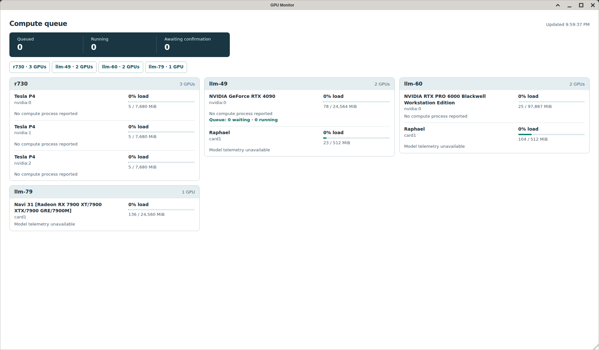

# GPU Monitor

System Tools → GPU Monitor shows the latest GPU sample and compute queue totals. Opening a window requests the current sample. Every refresh replaces that sample. The gateway shares one snapshot for 20 seconds across signed-in viewers. The sampler keeps only its latest reading in the user runtime directory. Queue records used to deliver jobs are separate from telemetry.

### Browser review

Verified in a signed-in WebOS development preview using telemetry from all four hosts. At each viewport, the app opened from System Tools, showed eight GPUs, exposed every host shortcut above the list, navigated to the last host, and closed. The content fit the window horizontally. Phone and tablet used Chromium touch emulation. Physical devices, Safari, and the hosted ksu.codes release still need testing.

[Phone (390 × 844)](screenshots/phone.png) · [Tablet (820 × 1180)](screenshots/tablet.png) · [1080p](screenshots/desktop.png) · [4K](screenshots/4k.png)

Each machine runs the user unit `webos-gpu-monitor.service`. Use `systemctl --user status|start|stop webos-gpu-monitor.service` with the desired action. An enabled unit starts with that user's systemd manager. Collection uses the installed NVIDIA tools or AMD sysfs counters. Unknown model or precision is displayed explicitly. Queue counts cover the connected WebOS inference coordinator.

Set `WEBOS_GPU_MONITOR=1` on the WebOS backend. Its service identity needs host-key-verified access to read the four fixed telemetry reports. Clients receive GPU metrics and model labels without process arguments, account IDs, or prompts. The app exposes no machine control.
